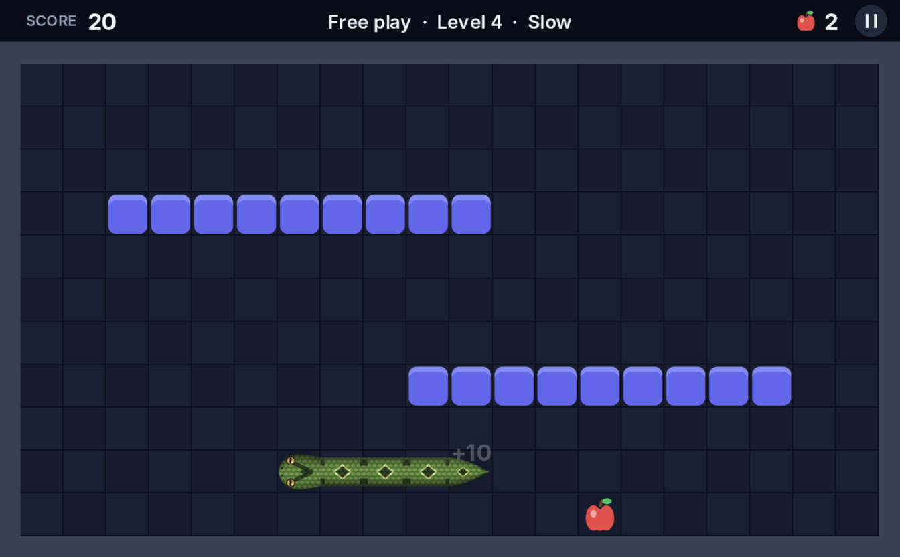
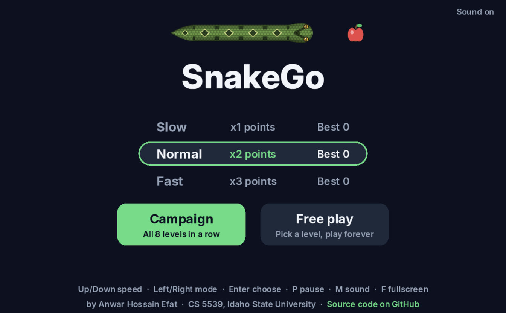
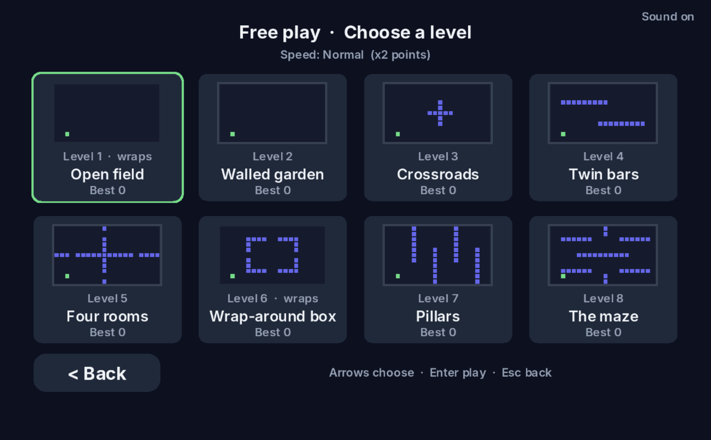
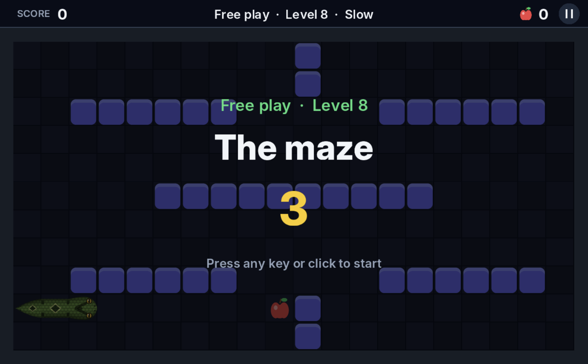
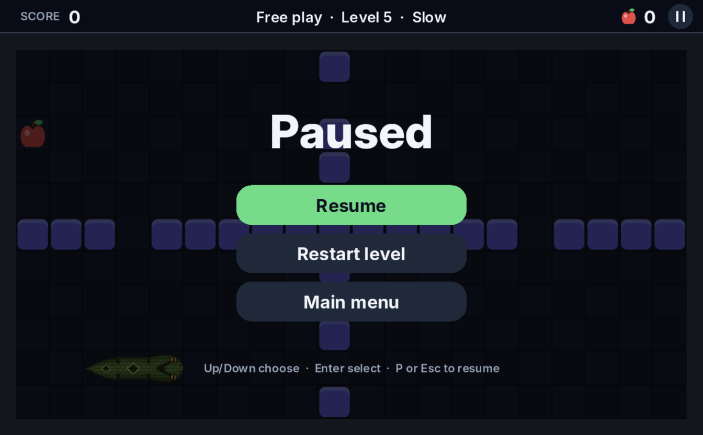
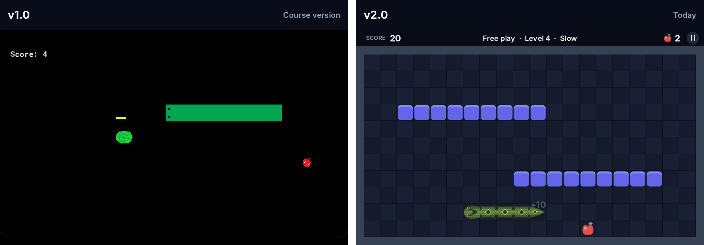
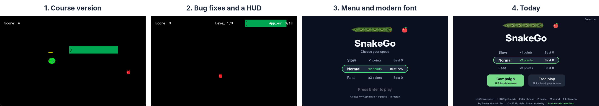

# SnakeGo

A modern take on the classic Snake game, made with GameMaker. Guide a realistic snake through eight levels, chase apples and time-limited watermelons, and beat your best score at three speeds. Runs in the browser on computers and phones.

### [▶ Play SnakeGo in your browser](https://anwarhossainefat.github.io/SnakeGo/)

SnakeGo started as my 2D game project for **CS 5539: Introduction to Computer Game Development** at **Idaho State University**. That original course version is tagged [`v1.0`](https://github.com/anwarhossainefat/SnakeGo/tree/v1.0). I then fixed its bugs, rebuilt the visuals, and added levels, modes, sound and mobile support for the current version.

## Features

- **8 levels** built from simple text maps: open fields that wrap around the edges, walled gardens, bars, rooms, pillars and a maze. Each one is a little faster than the last.
- **Two modes**
  - **Campaign:** play all 8 levels in a row, 10 apples per level.
  - **Free play:** pick any level and play forever, with a separate best score for every level.
- **Three speeds** with score multipliers: Slow ×1, Normal ×2, Fast ×3.
- **Watermelon bonus** every 4th apple: the faster you reach it, the more it's worth (50 points down to 10, times the speed multiplier).
- **Realistic snake** drawn from skin pieces (head, body, corner and tail) with scales, a diamond pattern, slit-pupil eyes and a flicking tongue.
- **High scores** saved on your device: one per speed for Campaign, and one per level and speed for Free play.
- **"Get ready" countdown** at the start of every level. Any key or tap starts it early.
- **Pause menu** with Resume, Restart and Main menu.
- **Sound effects generated in code** (no audio files), with a mute toggle that's remembered.
- **Works everywhere:** fills any window or screen and stays sharp (all artwork is drawn at 3× detail), resizable window and fullscreen on desktop, and swipe controls with a "rotate your phone" prompt on mobile.

## Screenshots

| Home | Choose a level (Free play) |
|---|---|
|  |  |
| **Get ready** | **Pause menu** |
|  |  |

## Before and after

How it changed, step by step:

## Controls

| Action | Keyboard | Touch |
|---|---|---|
| Steer | Arrow keys or WASD | Swipe |
| Pause / resume | P or Esc | Tap the **II** button |
| Restart | R | Pause menu → Restart |
| Sound on/off | M | Tap "Sound on" on the Home screen |
| Fullscreen | F | — |
| Menu | Up/Down speed, Left/Right mode, Enter choose | Tap |

Quick double turns work: tap "right, then down" fast and the snake makes both turns.

## The levels

| # | Level | Edges |
|---|---|---|
| 1 | Open field | Wraps around |
| 2 | Walled garden | Walls |
| 3 | Crossroads | Walls |
| 4 | Twin bars | Walls |
| 5 | Four rooms | Walls |
| 6 | Wrap-around box | Wraps around |
| 7 | Pillars | Walls |
| 8 | The maze | Walls |

Each level is a 20 × 11 text map in `objects/obj_menu/Create_0.gml`, where `#` is a block and `S` is the snake's start. To add a level, copy an entry and draw a new map.

## Run it yourself

1. Install [GameMaker](https://gamemaker.io/) (free for non-commercial use). This project was made with IDE **2024.14** (runtime 2024.14.3).
2. Clone this repository and open **`SnakeGo.yyp`** in GameMaker.
3. Choose your platform in the target bar (for example **macOS** or **Windows**) and press **Run** (F5).

### Build the web version

1. In GameMaker, set the target to **HTML5**, then **Build → Create Executable → Package as Loose Files** into a folder (by default `~/GameMakerProjects/SnakeGo-web`).
2. Run `bash tools/publish-web.sh` (or `bash tools/publish-web.sh /path/to/export`). It copies the export into `docs/` and swaps in the phone-friendly page from `web/index.html`.
3. Commit and push. GitHub Pages serves `docs/` at the link above.

## How it works

- **Grid movement with an input queue:** the snake moves one 32 px cell per tick, and key presses and swipes are queued so quick turns aren't lost.
- **Data-driven levels:** a single room (`rm_game`) is rebuilt by `obj_level` from the current level's text map.
- **Skin rendering:** the body objects are invisible collision boxes. The head draws the whole snake each frame, choosing and rotating a straight, corner or tail piece for each segment based on its neighbours, including across wrap-around edges.
- **Resolution-independent display:** `obj_display` resizes the drawing surface to the window and keeps the HUD lined up, so the game stays sharp from a phone to a 4K monitor.
- **Procedural audio:** each sound effect is synthesised into an audio buffer at startup (sine, square, triangle and noise notes with fade envelopes).
- **Custom text:** the [Inter](https://rsms.me/inter/) font is stored as glyph sprites, so text looks identical on desktop and in the browser.

## Project structure

| Path | What's there |
|---|---|
| `objects/obj_menu` | Menu screens, game settings, level maps, fonts, sounds, saved high scores |
| `objects/obj_level` | Builds each level from its map |
| `objects/obj_snakeHead` | Movement, input, collisions, scoring, HUD, pause menu, snake drawing |
| `objects/obj_display` | Window and screen scaling, fullscreen, "rotate your phone" |
| `objects/obj_apple`, `obj_watermelon` | Food spawning and drawing |
| `objects/obj_gameover` | End screen and high scores |
| `rooms/` | `rm_menu`, `rm_game`, `rm_gameover` |
| `web/`, `tools/` | Web page template and the publish script |
| `docs/` | The published web build (GitHub Pages) |

## Versions

- **[v1.0](https://github.com/anwarhossainefat/SnakeGo/tree/v1.0):** the original course project for CS 5539.
- **v2.0:** the current version, with bug fixes, new visuals, 8 levels, Free play, sound and mobile support.

## Credits

Made by **[Anwar Hossain Efat](https://anwarhossainefat.github.io/)**, MS student in Computer Science at Idaho State University.

Originally developed as the 2D game project for **CS 5539: Introduction to Computer Game Development**, Idaho State University.

Text uses the [Inter](https://rsms.me/inter/) typeface by Rasmus Andersson, licensed under the [SIL Open Font License 1.1](https://github.com/rsms/inter/blob/master/LICENSE.txt).
